# Formulatrix

Company website: [Formulatrix](https://formulatrix.com/)

> Formulatrix makes laboratory automation, including the Mantis and Tempest liquid dispensers.

## Mantis chips

| Description | Image | PLR definition |
|-------------|-------|----------------|
| 'mantis_chip_low_volume' Part no.: 233581 (pack of 6), 233649 (pack of 12) [manufacturer website](https://wcm.formulatrix.com/product/mantis-diaphragm-chip-silicone/) Silicone, Low Volume (LV), RFID; drops of 0.1 and 0.5 µL | 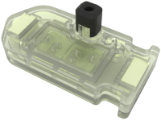 | `mantis_chip_low_volume` |
| 'mantis_chip_high_volume' Part no.: 233580 (pack of 6) [manufacturer website](https://wcm.formulatrix.com/product/mantis-diaphragm-chip-silicone/) Silicone, High Volume (HV), RFID; drops of 1 and 5 µL | 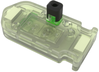 | `mantis_chip_high_volume` |
| 'mantis_chip_low_volume_hi_fi' Part no.: 809239A (pack of 6) [manufacturer website](https://wcm.formulatrix.com/product/mantis-diaphragm-chip-high-fidelity-silicone/) Silicone, Low Volume (LV) Hi-Fi, RFID; drops of 0.1 and 0.5 µL | 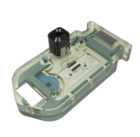 | `mantis_chip_low_volume_hi_fi` |
| 'mantis_chip_high_volume_hi_fi' Part no.: 806984A (pack of 6) [manufacturer website](https://wcm.formulatrix.com/product/mantis-diaphragm-chip-high-fidelity-silicone/) Silicone, High Volume (HV) Hi-Fi, RFID; drops of 1 and 5 µL | 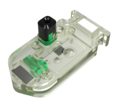 | `mantis_chip_high_volume_hi_fi` |

## Mantis chip nozzles

| Description | Image | PLR definition |
|-------------|-------|----------------|
| 'mantis_chip_nozzle_silicone_0_1mm' Part no.: 232994 [manufacturer website](https://help.formulatrix.com/mantis/5.5/Content/Chip_Overview.htm) silicone, 0.1 mm, red | 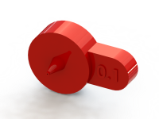 | `mantis_chip_nozzle_silicone_0_1mm` |
| 'mantis_chip_nozzle_silicone_0_2mm' Part no.: 232995 [manufacturer website](https://help.formulatrix.com/mantis/5.5/Content/Chip_Overview.htm) silicone, 0.2 mm, blue; the Low Volume chip's standard nozzle | 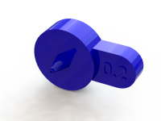 | `mantis_chip_nozzle_silicone_0_2mm` |
| 'mantis_chip_nozzle_silicone_0_3mm' Part no.: 232996 [manufacturer website](https://help.formulatrix.com/mantis/5.5/Content/Chip_Overview.htm) silicone, 0.3 mm, yellow | 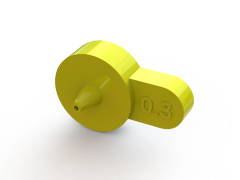 | `mantis_chip_nozzle_silicone_0_3mm` |
| 'mantis_chip_nozzle_silicone_0_4mm' Part no.: 232997 [manufacturer website](https://help.formulatrix.com/mantis/5.5/Content/Chip_Overview.htm) silicone, 0.4 mm, peach | 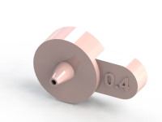 | `mantis_chip_nozzle_silicone_0_4mm` |
| 'mantis_chip_nozzle_silicone_0_5mm' Part no.: 206237 [manufacturer website](https://help.formulatrix.com/mantis/5.5/Content/Chip_Overview.htm) silicone, 0.5 mm, green; the High Volume chip's standard nozzle | 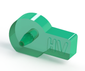 | `mantis_chip_nozzle_silicone_0_5mm` |
| 'mantis_chip_nozzle_silicone_0_6mm' Part no.: 232998 [manufacturer website](https://help.formulatrix.com/mantis/5.5/Content/Chip_Overview.htm) silicone, 0.6 mm, maroon | 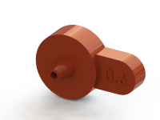 | `mantis_chip_nozzle_silicone_0_6mm` |
| 'mantis_chip_nozzle_silicone_1_0mm' Part no.: 819023A [manufacturer website](https://help.formulatrix.com/mantis/5.5/Content/Chip_Overview.htm) silicone, 1 mm, translucent | 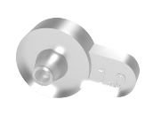 | `mantis_chip_nozzle_silicone_1_0mm` |
| 'mantis_chip_nozzle_pfe_0_15mm' Part no.: 232289 [manufacturer website](https://help.formulatrix.com/mantis/5.5/Content/Chip_Overview.htm) PFE, 0.15 mm, dark brown | 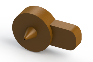 | `mantis_chip_nozzle_pfe_0_15mm` |
| 'mantis_chip_nozzle_pfe_0_3mm' Part no.: 232518 [manufacturer website](https://help.formulatrix.com/mantis/5.5/Content/Chip_Overview.htm) PFE, 0.3 mm, dark brown | 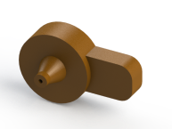 | `mantis_chip_nozzle_pfe_0_3mm` |
| 'mantis_chip_nozzle_0_8mm' Part no.: 836771A [manufacturer website](https://help.formulatrix.com/mantis/5.5/Content/Chip_Overview.htm) 0.8 mm, brown; for the XL Volume PFE chip | 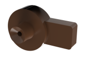 | `mantis_chip_nozzle_0_8mm` |
