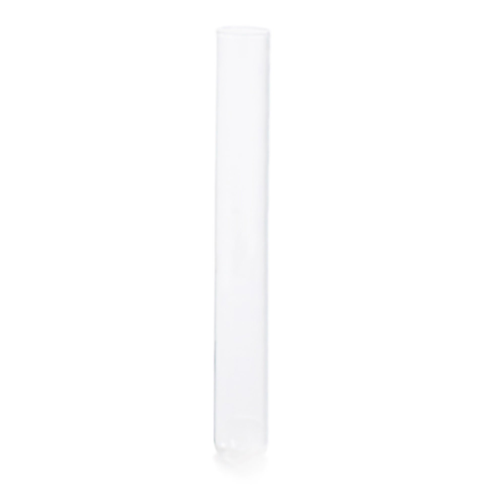

# McKesson

## Tubes

| Description | Image | PLR definition |
|-|-|-|
| McKesson Premium Glass Culture Tube Part no. 177-1505 [Manufacturer product page](https://mms.mckesson.com/product/1082085/McKesson-Brand-177-1505) · [Specifications](https://imgcdn.mckesson.com/CumulusWeb/Click_and_learn/premium_glass_culture_tubes_tear_sheet_2018-07.pdf) 12 mm OD × 75 mm, 5 mL Round-bottom borosilicate glass with a fire-polished rim Plain, clear, non-sterile, without closure 250/box, 4 boxes/case |  | `McKesson_tube_5mL_Rb` |
