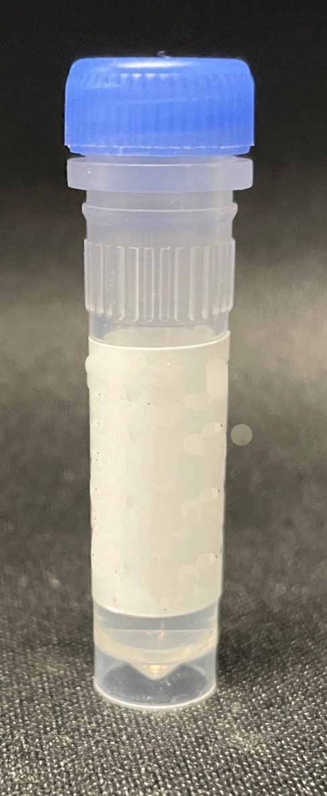

# Sarstedt

## Tubes

| Description | Image | PLR definition |
|-------------|-------|----------------|
| Screw-cap micro tube, 2 mL<br>Part no.: 72.609.300<br>[manufacturer website](https://www.sarstedt.com/en/MX/c/life-science/sample-handling/screw-cap-micro-tubes/p/screw-cap-micro-tube-2-ml/72.609.300)<br>Polypropylene, skirted tube with a conical interior bottom; uncapped definition. | <br>The photograph shows a cap; the definition represents the uncapped tube. | `sarstedt_tube_2mL_Vb` |

The definition uses a 10.8 mm diameter, 2,000 µL working volume, 45 mm overall height, and
44 mm inner depth. The cavity floor is 1 mm above the outside base of the skirt
(`material_z_thickness=1.0`).

### Height–volume calibration

Liquid heights were measured with micrometers from the outside base after filling the tube with
the volumes below. PyLabRobot's height–volume functions use height above the **cavity floor**, so
the calibration subtracts the 1 mm cavity-floor offset from each measurement. Height above the
cavity floor increases with volume; it is not a distance measured down from the top rim.

| Volume (µL) | Measured height above outside base (mm) | Height above cavity floor (mm) |
|------------:|---------------------------------------:|-------------------------------:|
| 50 | 3.55 | 2.55 |
| 100 | 4.12 | 3.12 |
| 200 | 7.20 | 6.20 |
| 300 | 9.61 | 8.61 |
| 400 | 11.29 | 10.29 |
| 500 | 13.35 | 12.35 |
| 600 | 15.10 | 14.10 |
| 700 | 16.81 | 15.81 |
| 800 | 18.63 | 17.63 |
| 900 | 20.62 | 19.62 |
| 1000 | 22.37 | 21.37 |
| 1500 | 31.55 | 30.55 |
| 2000 | 40.36 | 39.36 |

Both conversion functions use piecewise-linear interpolation between adjacent calibration points.
For points `(V₁, h₁)` and `(V₂, h₂)` surrounding the requested value:

```text
h(V) = h₁ + (V − V₁) × (h₂ − h₁) / (V₂ − V₁)
V(h) = V₁ + (h − h₁) × (V₂ − V₁) / (h₂ − h₁)
```

Here `h` is height above the cavity floor in mm and `V` is volume in µL. For example, 750 µL
corresponds to 16.72 mm above the cavity floor, or 17.72 mm above the outside base.

```python
from pylabrobot.resources import sarstedt_tube_2mL_Vb

tube = sarstedt_tube_2mL_Vb("sample")
height = tube.compute_height_from_volume(750)  # 16.72 mm above cavity floor
volume = tube.compute_volume_from_height(16.72)  # 750 µL
```

The supported range is **50–2000 µL**, corresponding to **2.55–39.36 mm above the cavity floor**.
Values outside these ranges raise `ValueError`, including zero volume. The model has no assumed
empty-tube point and does not extrapolate. Volume-based liquid heights and surface following
therefore require liquid levels within the measured calibration range.
